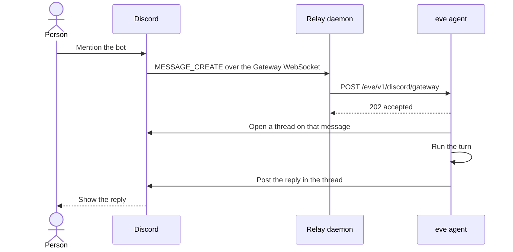

# Discord

The bot answers DMs, mentions, and threads. Discord delivers those over a Gateway WebSocket, which the relay in `daemon/` holds open and forwards to the agent.

## How a message travels

A mention in a channel takes this path. A direct message uses the same relay and skips the new thread: the reply stays in the DM.



The relay only carries the inbound message. The reply goes out through Discord's HTTP API. A slash command never touches the relay: Discord posts it straight to `/eve/v1/discord`.

## FAQ

1. **When someone tags the bot, does that open a new session?**

   A tag in a text channel does. The bot opens a thread on that message, and that thread gets a new session.

   Tagging the bot again in the channel, outside that thread, starts another thread and another session. Two people, or two unrelated questions, do not share context.

   A direct message does not open a thread or a new session per message. One DM conversation is one session.

   A reply to one of the bot's messages continues the session that posted it. If no live session owns that message, the reply starts a new thread.

   Mention the bot's user, not the role with the same name. Discord offers both, and a role mention does not address the bot.

2. **Is each thread a session?**

   Yes. Messages already in a thread continue that thread's session, including follow-ups that do not mention the bot. Those follow-ups need the Message Content intent, or Discord delivers them without text and the bot ignores them.

   | Message | Session |
   | --- | --- |
   | A DM | One per DM conversation |
   | A message in a thread | The session for that thread |
   | A mention in a text channel | A new thread, and a new session for it |
   | A reply to the bot in a text channel | The session that posted the replied-to message |

3. **Can the agent send and receive images?**

   It can receive them. An image attached to a mention, a DM, or a thread message is downloaded from Discord and passed to the model as a file, including an image with no caption. Files over 25 MB are not downloaded. The model gets a short note instead.

   It cannot send them, and a tool is not what is missing. When a turn finishes, Discord delivery receives only the reply text. That text is posted as JSON `{ content }` to Discord's HTTP API. Discord accepts an uploaded image only as multipart form data, and the channel's Discord client always sends JSON, including `channel.discord.post` and `channel.discord.request`. Image bytes never leave the agent.

   A tool would send an image only if that tool built the multipart upload itself, with the bot token and the Discord channel id. The channel has no helper for that. A URL in the reply text may still preview in the Discord client. That is a link preview, not an attached file.

4. **Can anyone in the channel tag it?**

   Yes. `agent/channels/discord.ts` has no allowlist. Anyone who can send a message in a channel the bot can see can mention it and get a reply. People who share a server with the bot can also DM it.

   Discord's own permissions still apply. Someone who cannot send messages, or cannot mention the bot, cannot reach it. The bot ignores other bots, including itself.

5. **Is the bot only added to a server?**

   The install link adds the bot to a server. Discord's bot invite only lists servers where you can add bots, usually because you own the server or have Manage Server. There is no "install to my DMs" choice on that screen.

   Direct messages work after that. Once the bot is in a server you are also in, open a DM with it. If none of the listed servers is the right one, create a server from the plus button in Discord's sidebar and run the install link again.

   Install URL:

   ```text
   https://discord.com/oauth2/authorize?client_id=1565419458829492325&scope=bot%20applications.commands&permissions=309237713920
   ```

6. **Why do we need a Dockerfile?**

   It is only for production. The agent on Vercel handles HTTP requests and cannot hold Discord's Gateway socket, so `daemon/main.ts` runs beside it as one always-on Vercel Daemon. `vercel.json` points that daemon at `daemon/Dockerfile`, which installs the relay's dependencies and starts it.

   Locally, skip the image and run the same program directly:

   ```bash
   EVE_URL=http://localhost:2000 node --env-file=.env.local daemon/main.ts
   ```

   `eve dev` needs to be running on port 2000. Run one relay per bot. A second relay, including a local one left running next to production, makes the agent answer twice.

7. **The local relay says the connector is not enabled for this environment**

   The local relay uses the development credential. Connect rejects it when the Discord connector is attached to production only.

   Attach development without removing production:

   ```bash
   npx vercel connect attach discord/bindu-eve -e production -e development --yes
   ```

   Then start the relay again. If Discord closes the connection, turn on **Message Content Intent** under **Bot** in the Developer Portal.
