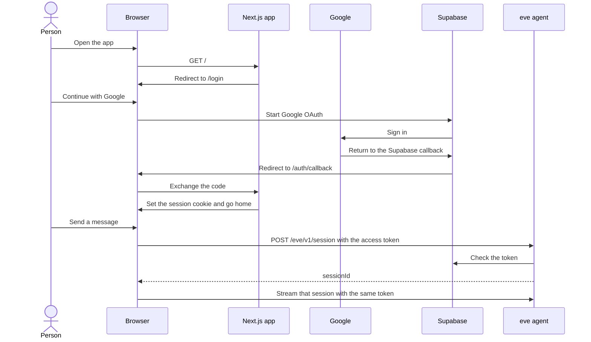

# Web sign-in

The web chat requires a signed-in account. Production uses Google. Local development also shows an email and password form. Discord and `eve dev` do not ask for a session. A `/s/:sessionId` link still opens for any signed-in person. Chats are not owned by a user yet.

## How a sign-in travels



The Next.js app stores the session in cookies, using `@supabase/ssr`. The server cannot read `localStorage`, and the login redirect runs on the server. The eve agent is a separate process. The browser sends the access token on each agent request, and the agent checks it with `@supabase/supabase-js`. It does not use the SSR package.

## Enable login

1. Create a Supabase project.
2. In Google Cloud, create an OAuth client of type **Web application**.
   - Authorized redirect URI: `https://<project-ref>.supabase.co/auth/v1/callback`
   - That URI is Supabase's, not this app's.
3. In Supabase, open **Authentication**, then **Sign In / Providers**, then **Google**. Turn it on and paste the Google client id and secret.
4. In Supabase, open **Authentication**, then **URL Configuration**. Add the app's callback, not the Supabase one:
   - Local: `http://localhost:<port>/auth/callback`
   - Production: `https://<your-domain>/auth/callback`
   - `<port>` is the port `npm run dev:all` prints.
5. Open the project's **Connect** dialog, or **Settings**, then **API Keys**. Copy the project URL and the **publishable** key (`sb_publishable_...`). Put the publishable key in `.env.local` at the repo root, and on the Vercel project for production:
   ```text
     NEXT_PUBLIC_SUPABASE_URL=https://<project-ref>.supabase.co
     NEXT_PUBLIC_SUPABASE_PUBLISHABLE_KEY=sb_publishable_...
   ```

     The Next.js app and the eve agent both read these. Do not commit the file.
6. Restart `npm run dev:all` after saving the env file.

## Development sign-in

When `NODE_ENV` is `development`, `/login` shows an email and password form under **Development only**. Production builds omit it. The app does not read `BINDU_DEV_EMAIL` or `BINDU_DEV_PASS`. Those stay in `.env.local` so a person or an agent can type them into the form. Do not add them to the production Vercel environment.

In the Supabase project, enable **Authentication**, then **Sign In / Providers**, then **Email**, and create the test user once. Agents should follow the sign-in steps in `AGENTS.md` when they need a session.

## Test it locally

Use `npm run dev:all`, then open the URL it prints.

1. `/` should send you to `/login`.
2. Choose **Continue with Google** and finish the Google screen. In development, you can instead fill the **Development only** email and password form and choose **Sign in**.
3. You should land back on the chat. Send a message.
4. Reload the `/s/:sessionId` URL. The same conversation should resume.
5. Choose **Sign out**. `/` should send you to `/login` again.

`npm run dev` is the terminal agent. It does not ask for Google. `npm run dev:web` starts only the website, so the login page can appear, but sending a message has no agent to reach.

Until the env vars exist, `/` redirects to `/login?error=config` and the button says Supabase is not configured.

If the browser shows **431** right after Google returns, the old session cookie is still too large. Clear cookies for the site and sign in again. The app stores only the access and refresh tokens in the cookie.

`npm test` runs the session, callback, and agent token checks.
